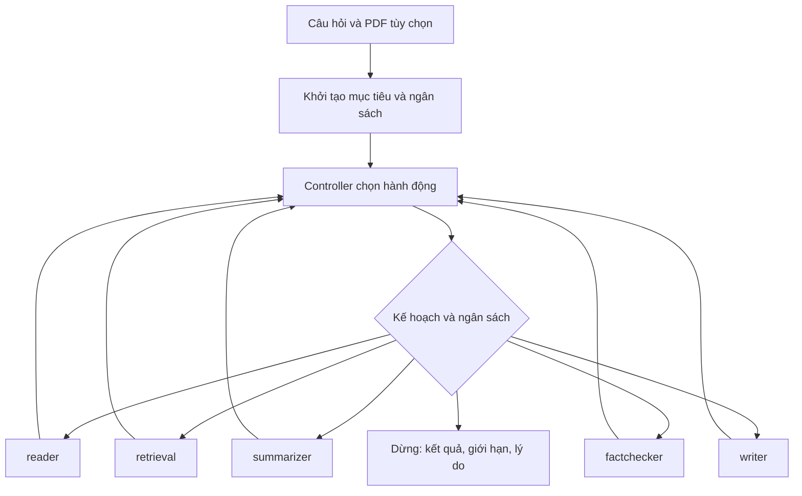

# Điều phối tự chủ cho một nhiệm vụ nghiên cứu

Cập nhật: 2026-09-30. Đây là cơ chế điều phối theo luật, dựa trên kết quả của
năm agent. Phạm vi dữ liệu là corpus/index được cấu hình hoặc một PDF đầu vào.
Controller tự chọn hành động tiếp theo và điểm dừng trong phạm vi công cụ/ngân
sách đã khai báo. Chất lượng quyết định vẫn phụ thuộc các model chuyên môn.

## Luồng thực thi



Ví dụ: Summarizer báo thiếu cỡ mẫu → controller dùng truy vấn do Summarizer đề
xuất → Retrieval đổi phương pháp, mở rộng top-k → Summarizer nhận context mới
kèm context đã thấy nếu còn chỗ → Fact-checker kiểm cả nguồn mới và nguồn cũ →
Writer viết từ claim đã xác minh. Nếu Writer báo còn thiếu nội dung, controller
có thể đọc/tìm tiếp. Backend lỗi, không đủ ngân sách hoặc yêu cầu cần làm rõ
sẽ đưa nhiệm vụ đến trạng thái dừng có lý do.

## Trách nhiệm các file

| File | Trách nhiệm |
| --- | --- |
| `research_rag/state.py` | Mục tiêu, `active_query`, việc đang làm, quyết định tiếp theo, kết quả agent, bằng chứng, lịch sử và ngân sách. |
| `research_rag/controller.py` | `Decision` và `AgentResult` được Pydantic kiểm tra; chọn hành động và áp giới hạn độc lập. |
| `research_rag/planning.py` | Schema kế hoạch, nhiệm vụ con/phụ thuộc/điều kiện hoàn thành, câu hỏi thiếu, sửa kế hoạch sau từng kết quả. |
| `research_rag/graph.py` | Năm node agent riêng; kiểm chứng nguồn, lọc câu Writer và tạo kết quả khi dừng. |
| `research_rag/retrieval.py` | RetrievalAgent chọn query/tool theo nhiệm vụ và feedback; RetrievalService thực thi BM25/dense. Fallback ghi phương pháp thực sự. |
| `research_rag/adapters.py` | Chọn trang bằng đối sánh từ trong câu hỏi với text preview, rồi dùng Reader hiện có để trích xuất. |
| `train_agent3_summarizer/node.py` | Trả yêu cầu thêm context ngay, kèm thông tin thiếu và truy vấn; không tiếp tục sinh lại trên cùng context khi đã yêu cầu thêm dữ liệu. |
| `train_agent3_summarizer/critic/prompts.py` | Hướng dẫn critic chỉ rõ dữ liệu thiếu; cho phép đề xuất truy vấn. |
| `research_rag/local.py` | Nạp model hiện có, cấu hình CLI, checkpoint SQLite, resume, timeout tiến trình và ghi sự kiện. |
| `research_rag/observe.py` | Thời gian, số bước/call, trạng thái và lý do dừng; không ghi nội dung nguồn vào metrics. |
| `scripts/build_validation_notebook.py` | Đóng gói runtime mới vào notebook phục hồi Kaggle, kèm hash kiểm chứng. |

`AgentResult` là contract **tại ranh giới graph**: `agent`, `completed`,
`evidence_source_ids`, `missing_information`, `suggested_action`, `suggested_query`.
Fact-checker và Writer được chuyển sang contract này bởi graph; checkpoint và
format huấn luyện của hai model đó vẫn dùng interface hiện có.

## Các điều kiện kiểm soát

- Mọi evidence span phải khớp nguồn theo quy tắc khoảng trắng/ligature hiện có.
- `seen_chunks` giữ nguồn qua các lượt tìm kiếm. Nguồn phản bác đã quan sát được
  vẫn được kiểm, kể cả khi lượt sau không truy xuất lại nguồn đó.
- Bằng chứng mới làm mất hiệu lực kết quả kiểm chứng cũ cho tới khi kiểm lại.
  Tìm kiếm rỗng không xóa báo cáo một phần đã có căn cứ.
- Các chunk giống hệt đã thấy không làm khởi động lại quá trình kiểm chứng.
- Writer chỉ nhận claim đã qua kiểm chứng. Graph kiểm cấu trúc/citation và chỉ
  giữ câu được critic của Writer đánh giá `supported`.
- `completed` yêu cầu có câu trả lời, không có cảnh báo hiện tại và critic của
  Writer không báo thiếu phạm vi trả lời. Đây là tiêu chí nội bộ, không chứng
  minh câu trả lời đúng tuyệt đối hoặc corpus đã đầy đủ.
- Hết ngân sách trước Writer: dùng bộ sinh sao chép claim có sẵn, không gọi LLM.
  Kết quả mang `partial` hoặc `insufficient_evidence` và `stop_reason`.

## Ngân sách và timeout

| Cấu hình | Mặc định / ý nghĩa |
| --- | --- |
| `max_steps` / `--max-steps` | 30 lần gọi agent; controller và bước dừng không tính vào đây. |
| `max_graph_retries` / `--max-graph-retries` | 1 lần tìm bổ sung, tức tối đa 2 lần search; khoảng cho phép 0–5. |
| `max_factcheck_calls` / `--max-factcheck-calls` | 120 lời gọi FactCheckerNode trên toàn nhiệm vụ, tăng để kiểm lại claim từ nhiều nhiệm vụ con; mỗi lời gọi có thể có nhiều lần gọi LLM nội bộ. |
| `max_seconds` / `--max-seconds` | 600 giây kể từ lúc graph bắt đầu; kiểm trước/sau mỗi agent và trước từng lời gọi Fact-checker. |
| `--process-timeout` | Tùy chọn: deadline cứng cho tiến trình con, gồm cả thời gian nạp model; hết hạn trả mã 124 và dừng cây tiến trình đó. |
| `max_cost_usd` / `--max-cost-usd` | Tùy chọn: trần dự trù USD. Phải cung cấp mức trần cho đủ năm hành động. |

Lời gọi model đồng bộ đang chạy không bị ngắt bởi `max_seconds`. Khi cần ngắt
model bị treo, dùng `--process-timeout`. Checkpoint lưu tại ranh giới node;
hành động đang chạy lúc tiến trình bị ngắt có thể thực thi lại khi resume.

`--action-cost-bounds path/to/bounds.json` nhận một JSON object với các khóa
`read`, `search`, `summarize`, `factcheck`, `write`. Mỗi giá trị phải là mức
trần USD không âm **do người vận hành xác định**, bao gồm các call/retry nội bộ
của cả hành động. Trước khi chạy, controller giữ chỗ mức đó vào
`reserved_cost_usd` và từ chối nếu vượt trần. Backend hiện chưa trả usage thống
nhất: `token_usage` và chi phí thực tế vẫn để `null`. Số dự trù không phải hóa
đơn nhà cung cấp; call bị ngắt/replay có thể phát sinh phí lại, cần đối soát
trước khi tiếp tục các tác vụ trả phí sau lỗi tiến trình.

Reader mặc định chỉ nhận PDF tối đa 20 trang, chọn tối đa 3 trang mỗi lần theo
text preview. Đây là heuristic đối sánh từ; trang scan vẫn nằm trong tập trang
chưa đọc và có thể được chọn ở lượt sau. Không coi trang chưa đọc là bằng chứng
không liên quan. Việc chọn trang cần được đánh giá thêm trên PDF nghiên cứu thật.

## Chạy bằng model thật trên host phù hợp

Trong thư mục gốc dự án, sau khi cài môi trường và checkpoint theo runbook hiện có:

```powershell
python -m pip install -r requirements-orchestrator.txt
python -m research_rag.local --question "How was the model evaluated?" --quantize-4bit --max-steps 20 --max-graph-retries 2 --max-seconds 600 --process-timeout 1800 --checkpoint-db research-runs/tasks.sqlite --thread-id study-001 --events-output research-runs/study-001.events.jsonl --metrics-output research-runs/study-001.metrics.json
```

Tiếp tục một nhiệm vụ bị gián đoạn, giữ cùng corpus/index, model và cấu hình
ngân sách/chính sách. Deadline cũ được giữ; nếu đã hết thời gian, graph dừng:

```powershell
python -m research_rag.local --resume --quantize-4bit --max-steps 20 --max-graph-retries 2 --max-seconds 600 --process-timeout 1800 --checkpoint-db research-runs/tasks.sqlite --thread-id study-001 --events-output research-runs/study-001.events.jsonl
```

CLI từ chối khởi tạo câu hỏi mới trên thread đã tồn tại. Tác vụ mới cần thread ID
mới. SQLite phục vụ chạy local/kiểm thử; nếu triển khai nhiều worker, chọn backend
checkpoint phù hợp và thiết kế quyền sở hữu task. Checkpoint và raw trace chứa
câu hỏi/nguồn; giữ chúng riêng tư. `.gitignore` đã bỏ qua `research-runs/` và SQLite.

Các `stop_reason` chính: `task_completed`, `search_budget_exhausted`,
`step_budget_exhausted`, `time_budget_exhausted`, `cost_budget_exhausted`,
`factcheck_budget_exhausted`, `needs_clarification`, `repeated_search_without_progress`
và mã lỗi agent. `partial` giữ phần có căn cứ; `needs_input` nêu thông tin cần làm rõ
trong `agent_result.missing_information`.

## Kiểm chứng và giới hạn

### Kế hoạch và quyền của agent

Planner hiện là **chính sách code có giới hạn**, không gọi LLM để lập kế hoạch.
Mẫu `Compare A and B`, `So sánh A với B` tạo t1/t2 thu thập bằng chứng và nhiệm vụ
`synthesis` phụ thuộc cả hai. Câu hỏi nhiều dấu hỏi được tách tối đa bốn nhiệm vụ.
Cách diễn đạt khác dùng một nhiệm vụ, hoặc người vận hành truyền `--plan` JSON theo
schema ResearchPlan. Không khẳng định phân rã đúng mọi câu hỏi tự nhiên. Không tăng
số model/call ẩn để lập kế hoạch.

Mỗi nhiệm vụ lưu câu hỏi, query, focus_terms, completion_criteria, trạng thái,
câu hỏi thiếu, claim và source IDs. Cổng hoàn thành thực thi kiểm chứng toàn bộ claim,
đối chiếu focus_terms trong câu trả lời và quan hệ phụ thuộc; mô tả completion_criteria
bằng văn bản là tài liệu cho người review, không phải bộ thực thi điều kiện tùy ý.
Đối chiếu tên phương pháp là heuristic, không chứng minh đã trả lời đủ ý nghĩa.
Writer critic vẫn kiểm độ bao phủ câu hỏi chung. Kết quả mới có thể sửa query, mở lại
nhiệm vụ có claim bị bác bỏ, hoặc kích hoạt nhiệm vụ phụ thuộc. plan_history ghi keep/
revise/advance và lý do. Nguồn mới yêu cầu kiểm lại cả claim của nhiệm vụ trước.

| Thành phần | Quyền quyết định trong runtime |
| --- | --- |
| Controller | Chọn nhiệm vụ, cấp hành động, kiểm ngân sách, giữ/sửa kế hoạch và dừng. |
| Retrieval | Tự chọn query từ nhiệm vụ/feedback; chọn BM25 hoặc dense; đánh giá số ứng viên mới; đề xuất tìm tiếp. Một tool call mỗi lần được giao việc. Có kết quả không đồng nghĩa đúng hoặc liên quan. |
| Reader | Chọn nhóm trang; chọn extraction/OCR/layout và fallback theo critic. |
| Summarizer | Generator/critic, sửa câu trả lời hoặc yêu cầu thêm context. |
| Fact-checker | Chọn nhãn, confidence và khuyến nghị; `authority=advise`. Không tự gọi search hay thay ngân sách. |
| Writer | Chọn sửa/xóa/chọn lại claim trong pool đã xác minh; đề xuất thêm bằng chứng. |

`agent_cycles` lưu quan sát, việc controller giao, hành động/đánh giá cục bộ và trả về
controller. Reader ghi page_trials, Summarizer ghi trials, Retrieval ghi actual_tool,
Writer giữ trace cũ. Backend attempts của Summarizer/Fact-checker/Writer có sự kiện
`backend_call`, gồm thời gian và lỗi. Đây là số lần gọi backend logic; không suy ra số
HTTP retry của SDK Reader. Usage/cost không đo được giữ null. File state/raw generation
trong bộ E2E chứa nội dung nguồn và phải giữ Private.

Đổi topology/schema nên **không resume checkpoint của graph bốn node cũ**.
Tạo thread mới. Kiểm thử resume hiện dùng ranh giới node `retrieval`; cùng một phiên
phải giữ cấu hình budget, retrieval policy và evidence policy.

### Bộ E2E đã chốt trước inference

Tiêu chí: `research_rag/evaluation/autonomy_criteria.json`. Lệnh `prepare` chốt hash
tiêu chí, năm ca kiểm soát và ba câu hỏi QASPER chọn theo SHA256, trước khi nạp model.
Không dùng gold evidence để nhắc model; gold chỉ vào scorer. QASPER hiện là held-out
**candidate**: audit cũ chưa loại trừ hết semantic overlap/pretraining exposure.
Ba ca chạy trên corpus của từng paper, không đại diện tìm kiếm toàn corpus.

```powershell
python -m research_rag.evaluation.autonomy prepare --directory research-runs/autonomy-new
python -m research_rag.evaluation.autonomy run --directory research-runs/autonomy-new --online-model-downloads
```

Trên Kaggle dùng `scripts/kaggle_autonomy_validation.ipynb` đã nhúng bộ chốt local;
ba cell: setup, kiểm hash/hiện tiêu chí, chạy model thật. Mỗi case lưu events, state,
metrics, automated gate và stop reason; thêm benchmark adaptive/BM25/dense và manifest
hash code. Notebook đặt timeout tiến trình 5400 giây; graph giới hạn 300 giây/case
giữa các call. Luôn lưu Output và Stop session sau khi hoàn tất.
Automated gate không thay người review: `overall_pass` giữ false cho đến khi có đánh giá
độc lập. Không dùng unit test hay lần chạy cũ làm bằng chứng model của runtime mới.

```powershell
.venv/Scripts/python.exe -m unittest discover -s research_rag/tests -q
.venv/Scripts/python.exe -m unittest discover -s 05_writer/tests -q
```

`test_autonomy.py` kiểm luồng hoàn thành, yêu cầu context, phục hồi sau tìm thêm,
đọc thêm trang, điều kiện dừng, trần chi phí/call, report một phần, lọc câu sai,
SQLite đóng/mở và resume, deadline cũ và timeout tiến trình. Backend trong các
test điều phối là giả lập có chủ đích; các test này không đo chất lượng model.
Lượt kiểm tra local ngày 2026-09-30: 80 test `research_rag` và 65 test Writer đạt.

Bản điều phối mới cần chạy lại E2E trên GPU/API với cùng tập dev để so sánh với
workflow cũ: chất lượng claim/citation, tỷ lệ trả lời thiếu căn cứ, độ phủ câu hỏi,
khả năng từ chối, số call, latency và chi phí nếu đo được. Ngưỡng Fact-checker
hiện có chưa được calibration. Chưa có kết quả E2E model thật cho bản thay đổi này.

Tài liệu API tham chiếu: [LangGraph Graph API](https://docs.langchain.com/oss/python/langgraph/graph-api),
[persistence](https://docs.langchain.com/oss/python/langgraph/persistence),
[SQLite checkpointer](https://pypi.org/project/langgraph-checkpoint-sqlite/).
